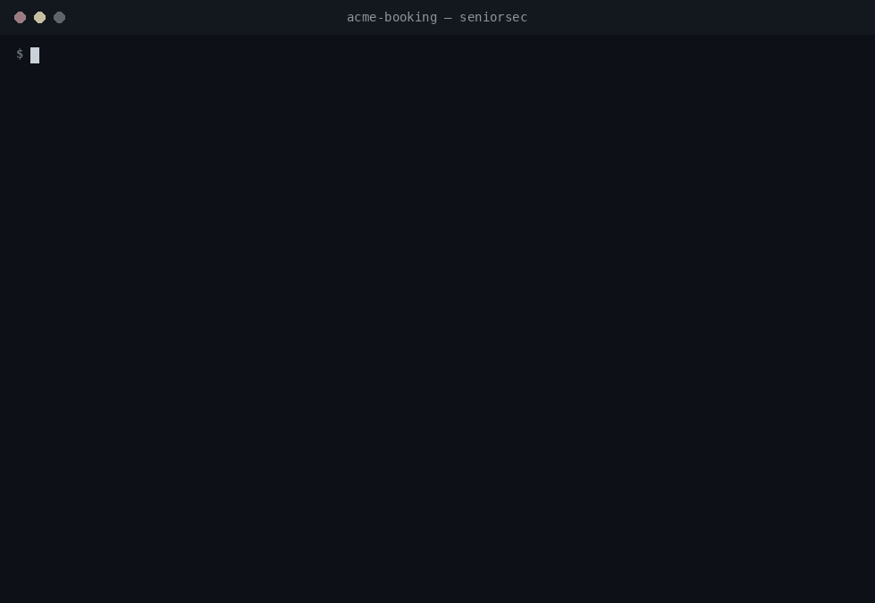
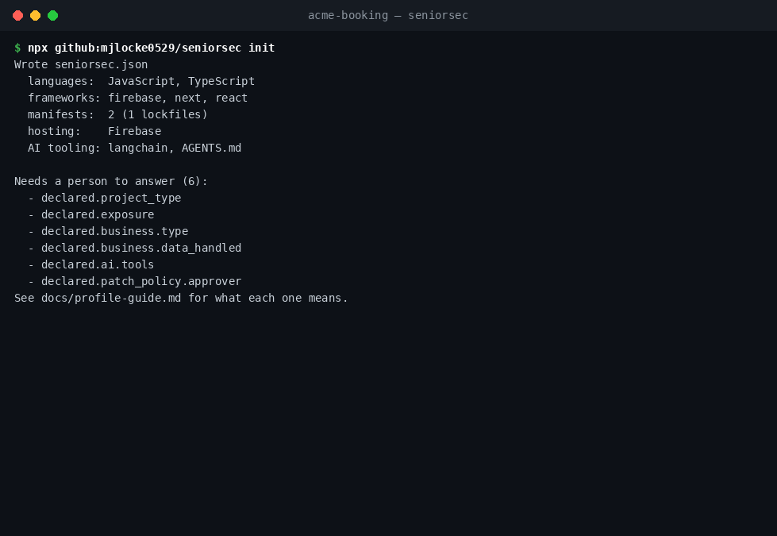
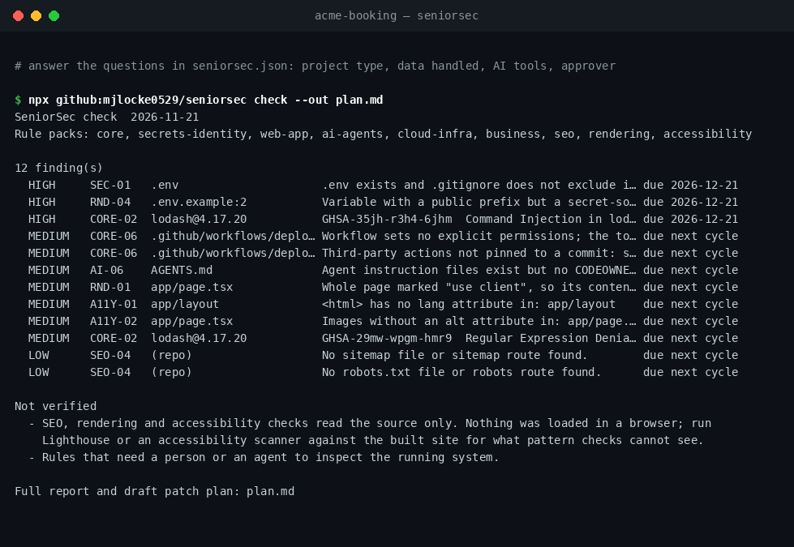
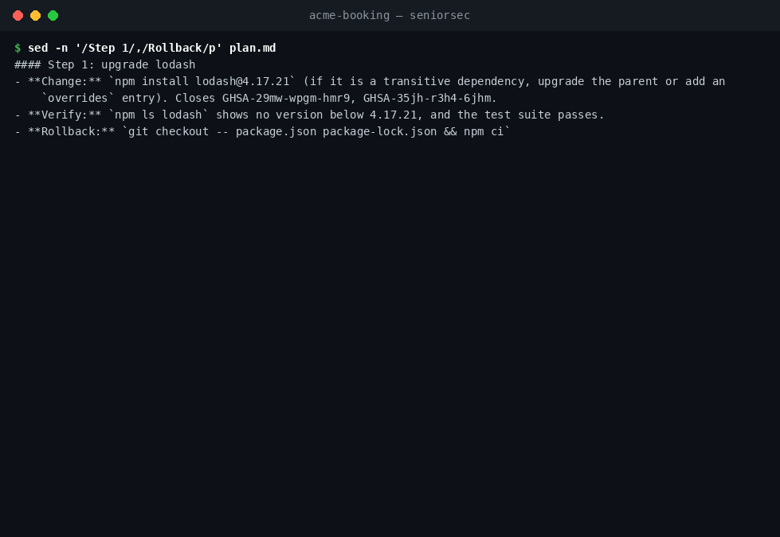

# SeniorSec

The senior security engineer every repo should have.

SeniorSec is a security and ship-readiness guide written for AI agents, plus a small command-line tool that applies it to your project. It tells an agent what "ready" means for *your* kind of project and business, checks the project against it, and writes a patch plan another agent can carry out.



*Recorded on a sample project.*

## Why use it

Most small teams have no security engineer. They have a dependency bot that opens pull requests, and an AI assistant that will write whatever it is asked to. Neither one knows that the app takes card payments, that the agent can send email, or that a critical fix has to land within a week.

SeniorSec fills that gap with three things:

- **A standard to work to.** 63 rules in 10 packs, each with a check and a fix, so an agent applies the same judgment every time instead of improvising.
- **Your context, written down once.** A `seniorsec.json` profile records what the project is, what data it holds and who approves fixes. Rules and deadlines follow from it.
- **A plan, not a list.** Findings come out as numbered steps with a verification and a rollback for each, ready to hand to a worker agent or a developer.

## How to run it

Run these from the root of the project you want checked. Nothing is installed into your project. You need Node 18 or newer.

**1. Create the profile.**

```bash
npx github:mjlocke0529/seniorsec init
```

`init` scans the repo and writes `seniorsec.json`. It fills in what it can detect and lists what a person has to answer.



**2. Answer the questions, then check.**

Open `seniorsec.json` and fill in the `declared` section. [`docs/profile-guide.md`](docs/profile-guide.md) explains each field. Then:

```bash
npx github:mjlocke0529/seniorsec check --out plan.md
```

`check` prints a short summary and writes the full report to `plan.md`.



**3. Read the plan.**

Each step names the change, how to verify it and how to undo it.



Hand `plan.md` and [`templates/worker-task.md`](templates/worker-task.md) to a worker agent, or do the steps yourself.

**Exit codes:** `0` clean, `1` findings, `2` a finding is on CISA's exploited list, `3` a lookup could not run (so "no findings" is not proven).

## What it checks

A pack is one file of rules about one topic. The same `check` command applies whichever packs your profile calls for.

| Pack | Rules | Applies to |
|---|---|---|
| core | 6 | Every project |
| secrets-identity | 5 | Every project |
| web-app | 7 | Web apps, APIs and mobile backends |
| wordpress | 7 | WordPress sites |
| ai-agents | 9 | Anything that calls a model or is worked on by agents |
| cloud-infra | 7 | Anything with hosting |
| business | 6 | Any business handling non-public data |
| seo | 6 | Public sites |
| rendering | 5 | Web apps and static sites |
| accessibility | 5 | Web apps, static sites and WordPress |

The first seven are security. The last three are ship-readiness: titles and metadata, sitemap and robots, content that is actually in the server's HTML, raw-HTML sinks, secrets behind a public prefix, page language and image alt text. Adding a topic means adding a file; see [`guide/README.md`](guide/README.md).

## What it does to your project

SeniorSec is built to be safe to point at a codebase you care about.

- **Reads** source files, manifests and lockfiles.
- **Writes** two files, both in your project root: `seniorsec.json` and the report you name with `--out`.
- **Sends** npm package names and versions to OSV.dev, and downloads the public CISA KEV list. `--offline` skips both.
- **Never** installs anything, runs your code, edits your source, or contacts any other service.
- **Has no dependencies.** The whole tool is one file you can read: [`cli/seniorsec.mjs`](cli/seniorsec.mjs).

## Skills

If you use a coding agent that supports skills in the `SKILL.md` format, three are included in [`skills/`](skills/):

| Skill | What it does |
|---|---|
| `seniorsec-check` | Sets up the profile, runs the check and explains the findings |
| `seniorsec-plan` | Turns a finding or an advisory into a patch plan with verify and rollback per step |
| `seniorsec-patch` | Executes an approved plan step by step and opens a pull request |

Copy the folders you want into your agent's skills directory. Each skill states what it reads, writes and sends before it does anything, and none of them merges or pushes to your default branch.

## What ongoing looks like

SeniorSec is meant to run continuously, not once.

| When | What happens | Who does it | Automated today |
|---|---|---|---|
| Every pull request | `check` runs; the job fails if something exploited is found | GitHub Action | Yes |
| Weekly | `check` re-runs against fresh vulnerability data, since new advisories appear for code that has not changed | GitHub Action | Yes |
| Daily to weekly | Feeds in `sources/registry.json` are read; relevant items become notes in `intake/` | Scout agent | Role defined, you run it |
| When an item changes a rule | The rule pack is edited in a pull request that links the evidence | Scout agent, a person approves | Role defined, you run it |
| When a finding appears | A patch plan is written with a deadline from your `patch_policy` | Planner agent or `check` | Dependency plans: yes. Others: by agent |
| When a plan is approved | The steps are executed and a pull request is opened | Worker agent, a person merges | Role defined, you run it |
| When the business changes | You update the `declared` half of the profile | You | No, by design |

To turn on the automated rows, copy [`examples/seniorsec-workflow.yml`](examples/seniorsec-workflow.yml) into `.github/workflows/` in your project. The agent roles are specified in [`AGENTS.md`](AGENTS.md); point your agent of choice at that file.

## Why this is different

SeniorSec does not replace a scanner. It uses the same public vulnerability data scanners use. The difference is what surrounds that data.

| | Dependency bots and scanners | Security checklists | An AI assistant alone | SeniorSec |
|---|---|---|---|---|
| Knows your business and data | No | No | Only if told each time | Yes, from the profile |
| Covers AI and agent risks | Rarely | Sometimes | Inconsistent | A dedicated pack, mapped to OWASP and MITRE ATLAS |
| Covers business process | No | Sometimes | Inconsistent | Yes |
| Output | Alerts and version bumps | A document | Prose | A plan with verify and rollback per step |
| Written for agents to follow | No | No | n/a | Yes: rule IDs, fixed formats, role instructions |
| Stays current | Vulnerability data only | Goes stale | Training cutoff | Guide updated from tiered sources through reviewed pull requests |
| Adds to your supply chain | Often | No | No | No: zero dependencies, nothing installed |
| Says what it did not check | Rarely | No | Rarely | Always, in a "Not verified" section |

Two design choices matter most:

- **Limits live in credentials, not prompts.** The guide treats a written instruction to an agent as a reminder, not a control. Rules point to scoped tokens, approvals and sandboxes.
- **News is a lead, not a fact.** Nothing changes the guide or triggers a plan until a primary source confirms it and it matches the project.

## Sources and validation

25 sources in three tiers. [`sources/README.md`](sources/README.md) has the full validation rules.

| Tier | Sources | Role |
|---|---|---|
| Foundation | OWASP Top 10:2025, OWASP LLM Top 10 and Agentic Top 10 (2026), OWASP ASVS, MITRE ATLAS, NIST SSDF and its generative-AI profile, CWE Top 25, OpenSSF Scorecard, WCAG 2.2, Google Search Central, schema.org, the Clouds Against Humanity wiki | Shape the rules |
| Primary | CISA KEV, OSV.dev, GitHub Advisory Database, NVD, FIRST EPSS, CISA advisories, Wordfence Intelligence | Confirm a finding and set its priority |
| News | BleepingComputer, The Hacker News, SANS Internet Storm Center, Krebs on Security, AI Incident Database | Leads only |

A vulnerability becomes a plan only when a primary source confirms it **and** the project runs the affected version. Priority is: exploited now (KEV), then likely to be exploited (EPSS), then severity.

## Status

Early release (v0.3). See [`CHANGELOG.md`](CHANGELOG.md).

| Piece | State |
|---|---|
| Guide rule packs | First draft, 10 packs, 63 rules |
| Source registry | 25 sources |
| `init` | Detects Node, Python, Ruby, PHP/WordPress, Go and Rust projects |
| `check` | Security: four static checks, plus npm lockfiles against OSV with CISA KEV cross-reference (other ecosystems are detected and reported as not checked). Ship-readiness: source-level SEO, rendering and accessibility checks |
| Skills | Three, written and not yet exercised in a live agent |
| Performance pack | Not started; will wrap Lighthouse |
| EPSS, NVD, Wordfence | Listed and documented; not yet queried by `check` |
| Scout / Planner / Worker roles | Documented in `AGENTS.md`, not automated |

## Repo layout

```
AGENTS.md               entry point for any agent working in or with this repo
guide/                  the rules, one file per rule pack
skills/                 check, plan and patch skills for your own agent
sources/                source registry, validation rules, wiki index
intake/                 dated findings from the feeds
plans/                  patch plans
templates/              patch plan, worker task and intake note formats
docs/profile-guide.md   how to write seniorsec.json for your project
schema/                 JSON Schema for seniorsec.json
cli/                    the init and check commands (zero dependencies)
action/                 reusable GitHub Action
examples/               sample profiles and the workflow file
```

## What SeniorSec is not

It is not a penetration test, a compliance certification or a guarantee. It automates part of each rule pack and tells you which part it did not. A person approves every guide change and every patch.

## License and attribution

Apache-2.0. Parts of the guide are informed by the [Clouds Against Humanity wiki](https://github.com/ChiefGyk3D/Clouds-Against-Humanity/wiki) by ChiefGyk3D, also Apache-2.0. See `NOTICE`.
